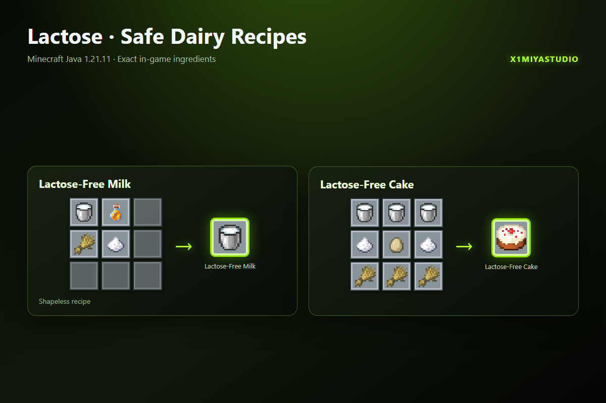

  <b>Исходный код датапака Lactose для классических версий Minecraft (1.16.5 – 1.20.4).</b> 
  Полная поддержка классического NBT синтаксиса, безлактозного молока, торта и всех механик выживания.

---

> [!NOTE]
> Исходный код для современных версий Minecraft (**1.20.5 – 26.3+**) с системой Dynamic Overlays находится в ветке [**master**](https://github.com/X1miyaStudio/Lactose/tree/master).

---

### ✨ Features / Особенности (Legacy 1.16.5 – 1.20.4)

- 👤 **Индивидуальная физиология** — раздельный расчёт реакций для каждого игрока.
- ⚡ **Динамическая адаптация** — постепенное привыкание, повышение толерантности при регулярном потреблении.
- 🌶 **Гибкие профили сложности** — режимы `soft`, `default`, `spicy` и `challenge mode`.
- 🎲 **Случайные события** — удачное усвоение (*lucky digestion*), молочные катастрофы и реакции коров.
- 🏆 **Кастомное древо достижений** — адаптировано под синтаксис 1.16.5–1.20.4 (`item` вместо `id`, фон `husbandry.png`).
- 🍰 **Безлактозная кулинария** — нативный крафт безлактозного молока и торта на обычном верстаке.

---

### 🥣 Crafting / Крафты

* **Безлактозное молоко:** крафтится из ведра молока, бутылочки мёда, пшеницы и сахара.
* **Безлактозный торт:** собирается в верстаке по стандартной раскладке торта с использованием трёх вёдер молока.

---

### ⚙️ Main Commands / Основные команды

| Команда | Описание |
|---|---|
| `/function lactose:config/soft` | Мягкий режим реакций |
| `/function lactose:config/default` | Стандартная сбалансированная сложность |
| `/function lactose:config/spicy` | Хардкорный режим |
| `/function lactose:config/challenge_on` | Включение режима испытания |
| `/function lactose:stats/show` | Просмотр текущей статистики переносимости |
| `/function lactose:admin/help` | Справка администратора |
| `/function lactose:uninstall` | Корректное удаление данных датапака |

---

### 📦 Installation / Установка

1. Скачайте архив датапака `Lactose_Legacy_v2_RU.zip` (или `EN.zip`) из [Релизов](https://github.com/X1miyaStudio/Lactose/releases).
2. Поместите его в папку `<мир>/datapacks/`.
3. Выполните команду `/reload` в игре.

---

Minecraft Java Edition **1.16.5 – 1.20.4** · Namespace `lactose`  
© 2026 **[X1miyaStudio](https://github.com/X1miyaStudio)**

