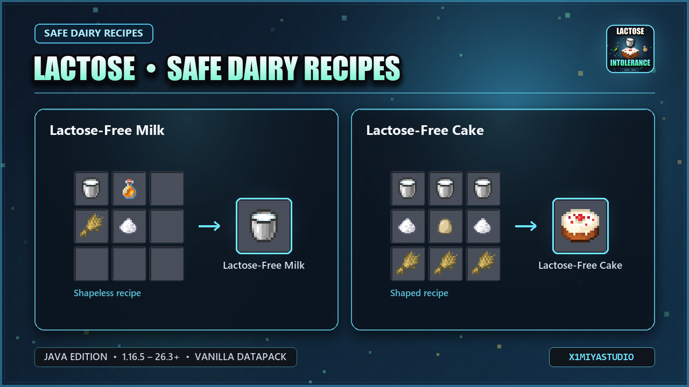

  
  

  <b>A full lactose intolerance survival system for Minecraft Java Edition.</b> 
  Turns ordinary milk into a deep survival mechanic with physiological reactions, tolerance adaptation, and lactose-free cooking.

---

> [!TIP]
> **Looking for older Minecraft versions?**  
> Source code and builds for classic Minecraft (**1.16.5 – 1.20.4**) are available in the official [**`legacy`**](https://github.com/X1miyaStudio/Lactose/tree/legacy) branch.

---

### ✨ Features

- 👤 **Per-Player Physiology** — individual digestion state, tolerance, and reactions tracked independently in both singleplayer and multiplayer.
- ⚡ **Dynamic Adaptation** — gradual adaptation builds tolerance over time, while spamming milk increases severity.
- 🌶 **Flexible Difficulty Profiles** — `soft`, `default`, and `spicy` modes plus competitive `challenge mode`.
- 🎲 **Random Events** — *lucky digestion*, *dairy disaster*, and reactions from witnessing cows.
- 🏆 **Custom Advancement Tree** — unique milestones and in-game player statistics.
- 🍰 **Lactose-Free Alternatives** — craftable lactose-free milk and lactose-free cake.

---

### 🥣 Crafting

* **Lactose-Free Milk:** crafted from a milk bucket, honey bottle, wheat, and sugar.
* **Lactose-Free Cake:** uses the classic cake crafting pattern with three buckets of lactose-free milk at a normal crafting table.

---

### ⚙️ Main Commands

| Command | Description |
|---|---|
| `/function lactose:config/soft` | Soft reaction profile |
| `/function lactose:config/default` | Default balanced difficulty |
| `/function lactose:config/spicy` | Hardcore reaction profile |
| `/function lactose:config/challenge_on` | Enable competitive challenge mode |
| `/function lactose:stats/show` | View your current tolerance statistics |
| `/function lactose:admin/help` | Administrator command reference |
| `/function lactose:uninstall` | Cleanly remove all datapack scoreboards and data |

---

### 📦 Installation

1. Download the build matching your language ([Modrinth (EN + RU)](https://modrinth.com/datapack/lactose-intolerance) — `Lactose_v2.0.1_EN.zip` / `Lactose_v2.0.1_RU.zip`, or [CurseForge](https://www.curseforge.com/minecraft/data-packs/lactose-digestion-milk-survival-mechanics); [Legacy builds for 1.16.5 – 1.20.4](https://github.com/X1miyaStudio/Lactose/tree/legacy) are also available) and place the ZIP in `<world>/datapacks/`.
2. Run `/reload` in-game (or rejoin the world).

---

Minecraft Java Edition **1.20.5 – 26.3+** · Vanilla datapack · Namespace `lactose` · All Rights Reserved  
© 2026 **[X1miyaStudio](https://github.com/X1miyaStudio)**

