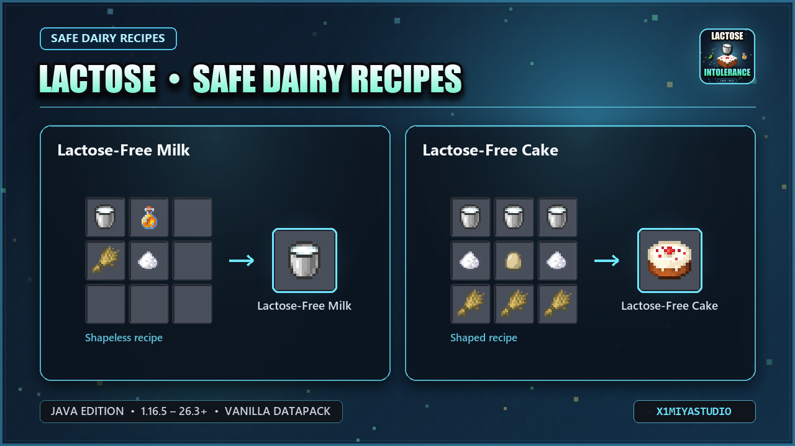

  
  

  <b>Полноценная система непереносимости лактозы в Minecraft Java.</b> 
  Превращает обычное молоко в глубокую механику выживания с физиологическими реакциями, адаптацией и безлактозной кулинарией.

---

> [!TIP]
> **Ищете версию для старых версий игры?**  
> Исходный код датапака для классических версий Minecraft (**1.16.5 – 1.20.4**) доступен в официальной ветке [**`legacy`**](https://github.com/X1miyaStudio/Lactose/tree/legacy).

---

### ✨ Особенности

- 👤 **Индивидуальная физиология** — раздельный расчёт реакций для каждого игрока как в одиночной игре, так и на сервере.
- ⚡ **Динамическая адаптация** — постепенное привыкание, повышение толерантности при регулярном потреблении и штрафы за спам молоком.
- 🌶 **Гибкие профили сложности** — режимы `soft`, `default`, `spicy` и соревновательный `challenge mode`.
- 🎲 **Случайные события** — удачное усвоение (*lucky digestion*), молочные катастрофы (*dairy disaster*) и реакции коров-свидетелей.
- 🏆 **Кастомное древо достижений** — уникальные испытания и внутриигровая статистика.
- 🍰 **Альтернативная кулинария** — безлактозное молоко и безлактозный торт.

---

### 🥣 Крафты

* **Безлактозное молоко:** крафтится из ведра молока, бутылочки мёда, пшеницы и сахара.
* **Безлактозный торт:** собирается в верстаке по стандартной раскладке торта с использованием трёх вёдер безлактозного молока.

---

### ⚙️ Основные команды

| Команда | Описание |
|---|---|
| `/function lactose:config/soft` | Мягкий режим реакций |
| `/function lactose:config/default` | Стандартная сбалансированная сложность |
| `/function lactose:config/spicy` | Хардкорный режим |
| `/function lactose:config/challenge_on` | Включение режима испытания |
| `/function lactose:stats/show` | Просмотр текущей статистики переносимости |
| `/function lactose:admin/help` | Справка администратора |
| `/function lactose:uninstall` | Корректное удаление данных датапака |

---

### 📦 Установка

1. Скачайте нужную версию датапака ([Modrinth (EN + RU)](https://modrinth.com/datapack/lactose-intolerance) — `Lactose_v2.0.1_EN.zip` / `Lactose_v2.0.1_RU.zip`, [CurseForge](https://www.curseforge.com/minecraft/data-packs/lactose-digestion-milk-survival-mechanics) — EN + RU; также доступны [Legacy-сборки для 1.16.5 – 1.20.4](https://github.com/X1miyaStudio/Lactose/tree/legacy)) и поместите архив в папку `<world>/datapacks/`.
2. Выполните команду `/reload` в игре (или перезапустите мир).

---

Minecraft Java Edition **1.20.5 – 26.3+** · Ванильный датапак · Namespace `lactose` · All Rights Reserved  
© 2026 **[X1miyaStudio](https://github.com/X1miyaStudio)**

