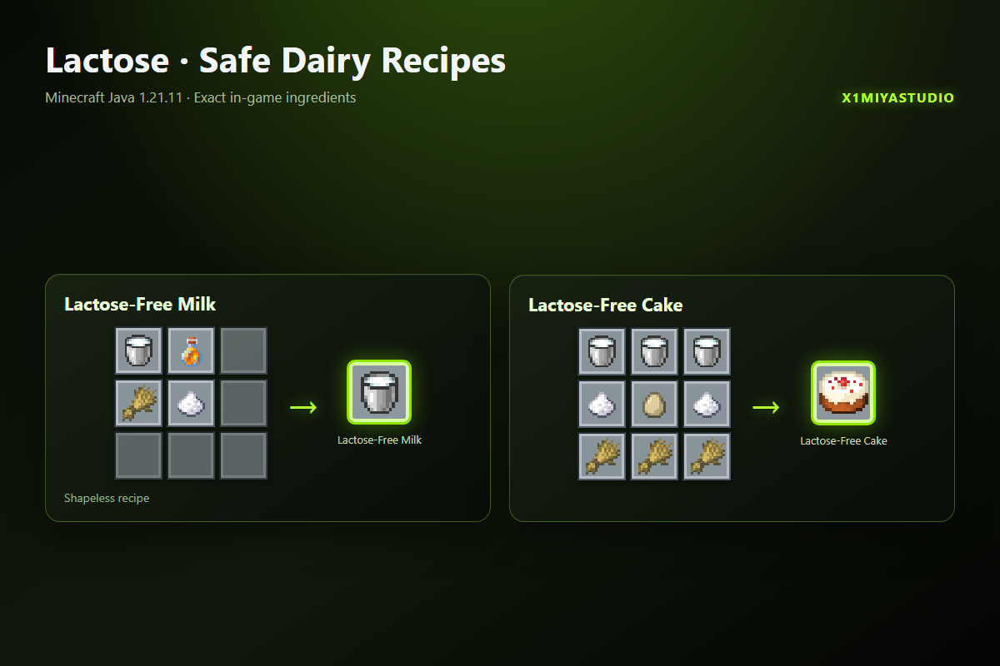

# Lactose

Lactose превращает молоко в небольшую систему выживания. Молоко вызывает временную реакцию, частое употребление повышает опасность, а восстановление постепенно развивает переносимость.

## Возможности

- Отдельная реакция для каждого игрока в одиночной и сетевой игре.
- Серии употребления, переносимость, адаптация и режим испытания.
- Мягкий, обычный и острый режимы.
- События удачного пищеварения, молочной катастрофы и наблюдающих коров.
- Собственная ветка достижений и статистика игроков.
- Безлактозное молоко и безлактозный торт.

## Крафты

Создай безлактозное молоко из молока, мёда, пшеницы и сахара. Безлактозный торт использует обычную схему торта с тремя вёдрами молока и создаётся прямо на верстаке.

## Основные команды

- `/function lactose:config/soft`
- `/function lactose:config/default`
- `/function lactose:config/spicy`
- `/function lactose:config/challenge_on`
- `/function lactose:stats/show`
- `/function lactose:admin/help`
- `/function lactose:uninstall`

## Установка

Выберите подходящую сборку (`Lactose_v2.0.1_RU.zip` или `Lactose_v2.0.1_EN.zip`) и поместите ZIP в `<мир>/datapacks/`, затем выполните `/reload`.

## Ссылки

- **Modrinth (Русская версия):** https://modrinth.com/datapack/lactose-intolerance-ru
- **Modrinth (English):** https://modrinth.com/datapack/lactose-intolerance

Minecraft Java Edition **1.20.5 – 26.3+** · Ванильный датапак · Namespace `lactose` · All Rights Reserved · X1miyaStudio
